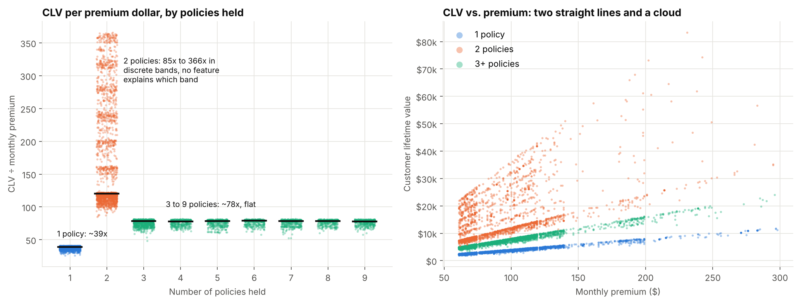
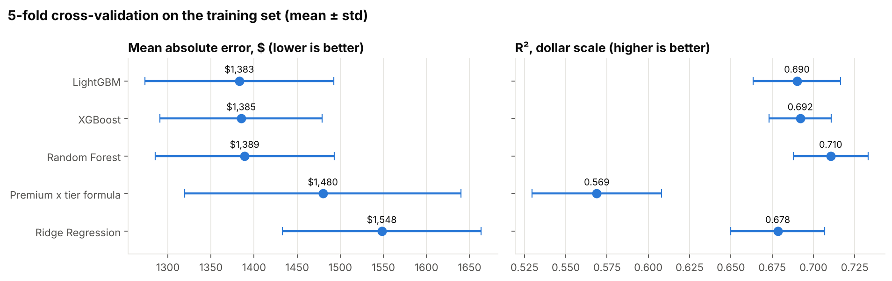
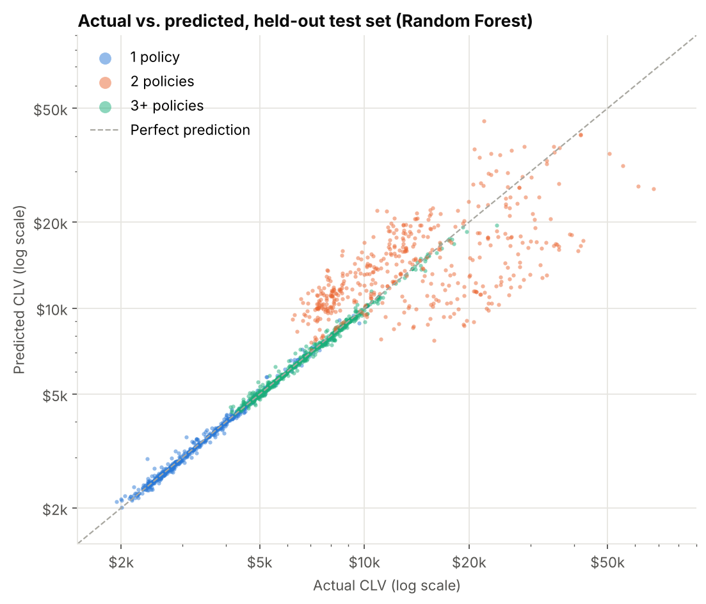
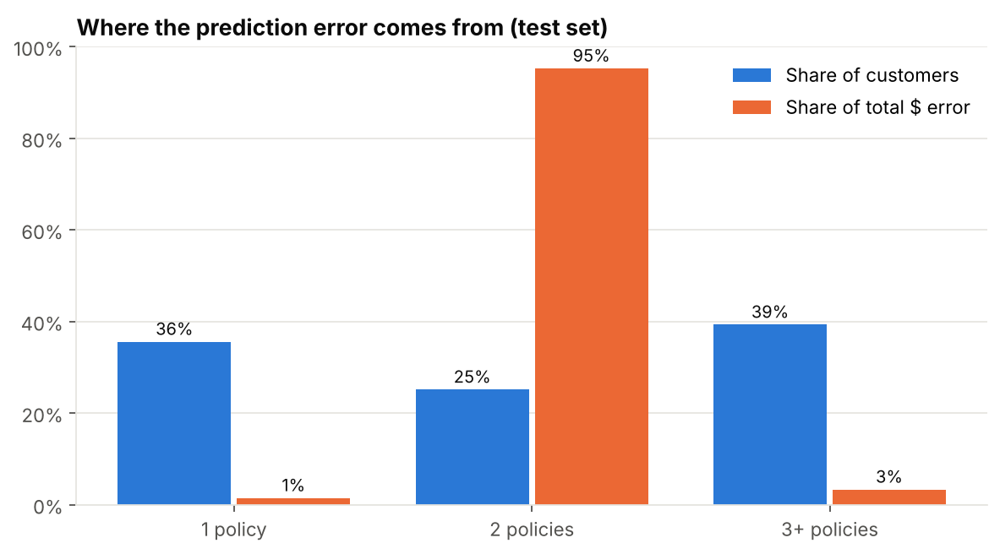
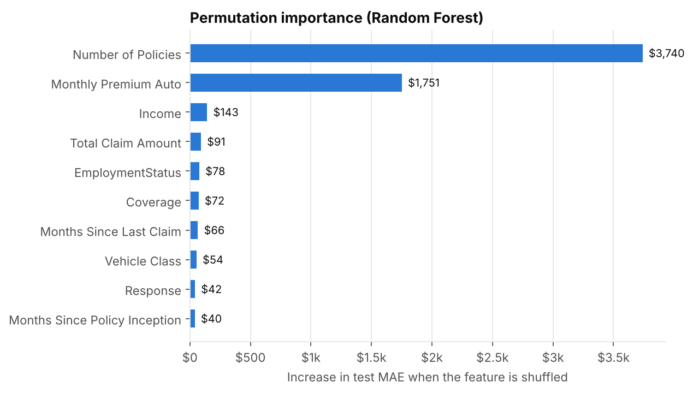
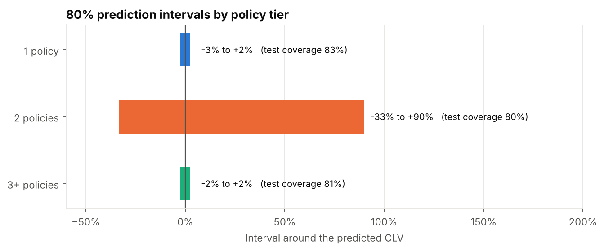

# Predicting Customer Lifetime Value in Auto Insurance

What drives customer lifetime value (CLV) for an auto insurer, how precisely can
it be predicted, and where should the business trust or distrust a prediction?
This project answers those questions on 9,134 policyholders, and the answer turns
out to be simpler and more useful than "a random forest scores R² 0.91".

**The core finding: CLV in this data is almost a formula.** It equals the monthly
premium times a multiplier set by how many policies the customer holds. That
two-input formula gets within a few points of tuned gradient boosting. Machine
learning sharpens the estimate for three quarters of customers, and for the
remaining quarter (customers with exactly two policies) no model does better
than a wide range, so the project reports calibrated prediction intervals
instead of pretending otherwise.

Data: IBM Watson Marketing Customer Value Analysis, 9,134 customers and 22
attributes (policy, coverage, premium, claims, demographics). CLV ranges from
$1,898 to $83,325, with a median of $5,780.

## Results

| | Random Forest (selected) | Two-input formula |
|---|---|---|
| R², dollar scale | **0.706** | 0.575 |
| R², log scale | 0.909 | 0.854 |
| Mean absolute error | **$1,343** | $1,429 |
| Median error | **1.4%** | 2.9% |
| Predictions within 10% of actual | **79%** | 75% |

All figures are on a held-out test set of 1,827 customers. The same model is
near-perfect or hopeless depending on the policy tier:

| Policy tier | Share of customers | Median error | Within 10% | Share of all $ error | 80% interval |
|---|---|---|---|---|---|
| 1 policy | 36% | 0.9% | 99% | 1% | -3% to +2% |
| 2 policies | 25% | 33% | 18% | **95%** | -33% to +90% |
| 3+ policies | 39% | 0.9% | 99% | 3% | -2% to +2% |

## The structure of CLV



Dividing CLV by monthly premium exposes how the value is built:

- **1 policy:** CLV is about **39×** the monthly premium, with almost no spread.
- **3 to 9 policies:** about **78×**, identical whether a customer holds 3 policies
  or 9. Beyond the third policy, count stops mattering.
- **2 policies:** anywhere from 85× to 366×, in discrete bands. A random forest
  trained on every available attribute explains only 10% of which band a customer
  lands in.

Two consequences follow. First, `Number of Policies` is not a linear feature: the
2-policy group has the highest average CLV ($15,723, versus $7,055 for 3+). A
linear model given the raw count cannot represent that, which is why the original
analysis concluded linear models fail (R² 0.43). Encoding the three tiers fixes it:
a ridge regression with that one change reaches log R² 0.90. Second, all the hard
prediction problems live in one group, so the evaluation should be split by group.

## Model comparison



| Model | CV MAE | CV R² ($) | Test MAE | Test R² ($) | Test R² (log) |
|---|---|---|---|---|---|
| Baseline (mean CLV) | $4,454 | 0.00 | $4,370 | 0.00 | -0.14 |
| Premium × tier formula | $1,480 ± 160 | 0.569 | $1,429 | 0.575 | 0.854 |
| Ridge Regression | $1,548 ± 115 | 0.678 | $1,513 | 0.676 | 0.899 |
| **Random Forest** | $1,389 ± 104 | 0.710 | **$1,343** | **0.706** | **0.909** |
| XGBoost | $1,385 ± 94 | 0.692 | $1,388 | 0.680 | 0.900 |
| LightGBM | $1,383 ± 109 | 0.690 | $1,372 | 0.684 | 0.901 |

Every learned model fits log(CLV) to handle the skew, and every model is scored
in dollars, the unit the business uses. The three tree ensembles are tied within
$6 of MAE against a fold-to-fold spread of about $100. Under the one-standard-error
rule the simplest of the tied models is selected, which is Random Forest; it also
has the best dollar-scale R².



## Where the error comes from



Two-policy customers are a quarter of the book and **95% of the dollar error.**
On that group the random forest is no better than the formula (MAE $5,092 versus
$4,976). The model's whole advantage comes from the predictable tiers, where it
cuts the formula's error by about two thirds (from $164 to $54 for single-policy
customers, and from $305 to $113 for 3+).



Permutation importance agrees. Shuffling `Number of Policies` adds $3,740 to the
test MAE and shuffling `Monthly Premium Auto` adds $1,751. The next feature,
income, adds $143. Demographics, vehicle, channel and claims history barely
register.

## Honest uncertainty: prediction intervals by tier



A single number is the wrong output for a 2-policy customer. The pipeline wraps
the model in split-conformal prediction intervals, calibrated separately for each
tier on out-of-fold training predictions and then checked on the test set. At an
80% target, actual test coverage is 83%, 80% and 81% for the three tiers.

In practice that means a $5,000 prediction for a single-policy customer comes
with a range of roughly $4,870 to $5,120. A $15,000 prediction for a two-policy
customer comes with a range of roughly $10,000 to $28,500, and should be treated
as such.

## What this means for the business

1. **Value is set by premium and policy tier.** In this data a customer with
   three or more policies is worth about twice as much per premium dollar as a
   single-policy customer (78× against 39×). Moving customers from one policy to
   three is the lever the data points to. The data is observational, so the size
   of that gain should be confirmed with a cross-sell test before it is booked.
2. **Score with confidence where it is earned.** For three quarters of customers
   the model is accurate to about 1%, which is good enough for automated
   decisions such as retention budgets and service tiers.
3. **Flag 2-policy customers for range-based decisions.** Their CLV can only be
   placed in a wide band. Use the interval's lower bound for spend limits, or
   gather the missing signal first.
4. **Question the 2-policy pattern itself.** A tier that out-earns customers with
   more policies, in discrete bands that no attribute explains, is not plausible
   as economics. It most likely reflects how the CLV field in this public sample
   was generated. In a real engagement this goes back to the data owner before
   anyone acts on it.

## Method

1. **Data checks.** No missing values. 25.4% of customers report zero income;
   these are kept and flagged rather than imputed.
2. **Features.** Policy tier (1, 2, 3+), log premium, premium-to-income ratio,
   claim per policy, renewal month, complaint and zero-income flags.
3. **Leak-free preprocessing** inside a scikit-learn `Pipeline`, so scaling and
   encoding are fit on training folds only.
4. **80/20 split, stratified by policy tier** (7,307 train, 1,827 test). The test
   set is used once, at the end.
5. **Log target, dollar evaluation** via `TransformedTargetRegressor`.
6. **Tuning:** 15-iteration randomized search per model, 5-fold CV, minimizing
   dollar MAE.
7. **Selection** by the one-standard-error rule over the learned models, with the
   formula as the benchmark to beat.
8. **Intervals:** per-tier split-conformal, calibrated on out-of-fold predictions.

## Limitations

- **This is a static, likely synthetic sample.** CLV is given rather than built
  from transaction histories, and its near-formulaic structure suggests it was
  generated. The modeling approach transfers to real data; the specific
  multipliers should not be quoted as insurance industry facts.
- **No time dimension.** Policy effective dates span only January and February
  2011, so there is no out-of-time validation.
- **Interval guarantees are on average.** Conformal coverage holds across
  customers in a tier, not for every individual.

## Run it

```bash
git clone https://github.com/kkriday/Predicting-Customer-Lifetime-Value-in-Auto-Insurance.git
cd Predicting-Customer-Lifetime-Value-in-Auto-Insurance
pip install -r requirements.txt
python run_pipeline.py
```

The full run takes about 10 minutes on a laptop and regenerates everything in
`reports/`. Results are reproducible with the fixed seed in `src/config.py`.

## Project structure

```
├── data/
│   └── WA_Fn-UseC_-Marketing-Customer-Value-Analysis.csv
├── src/
│   ├── config.py          # paths, seed, interval coverage
│   ├── data.py            # loading, policy tiers
│   ├── features.py        # feature engineering, preprocessing
│   ├── models.py          # formula benchmark, candidate models, search spaces
│   ├── evaluate.py        # metrics, error by tier, conformal intervals
│   └── plots.py           # report figures
├── reports/
│   ├── metrics.json       # every number quoted in this README
│   ├── model_comparison.csv
│   └── figures/
├── course_submission/     # original notebook, report and slides
├── run_pipeline.py        # end-to-end entry point
└── requirements.txt
```

## Tech stack

| Area | Tools |
|---|---|
| Language | Python 3.11 |
| Data | pandas, NumPy |
| Modeling | scikit-learn, XGBoost, LightGBM |
| Uncertainty | split-conformal prediction intervals |
| Visualization | Matplotlib |

## Project history and credits

This started as the final project for **MSA 8150, Machine Learning for Analytics**
at Georgia State University by **Kriday Kallalathil and Anusha Bellavara
Mallikarjuna**. The original notebook, report and slides are in
[`course_submission/`](course_submission/). The notebook expects the CSV in its
own folder, so copy it from `data/` to run it.

This version rebuilds that analysis. It adds the policy-tier finding, a formula
benchmark, LightGBM (listed as future work in the original), dollar-scale model
selection, per-tier error analysis and conformal prediction intervals. It also
corrects statements in the original write-up that its own outputs did not
support: the top driver is policy count, not premium; the engineered features
contribute little; and hyperparameter tuning did not improve the random forest.

Dataset: IBM Watson Marketing Customer Value Analysis, distributed on Kaggle.
